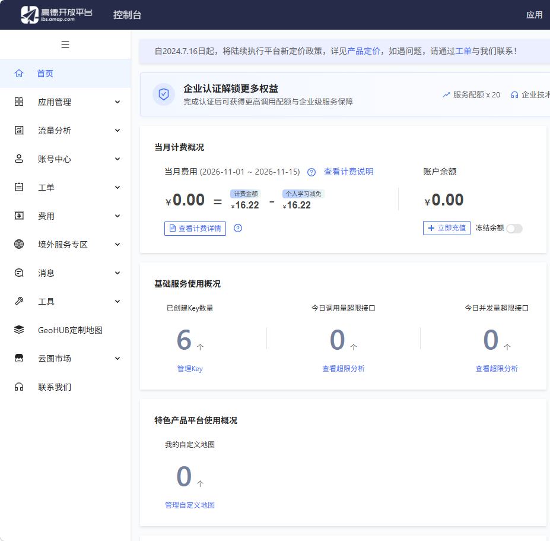
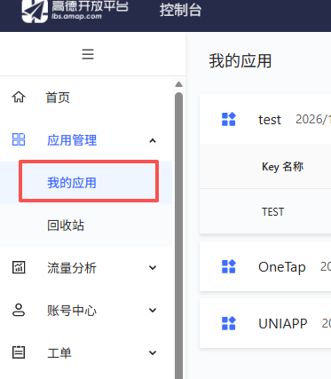
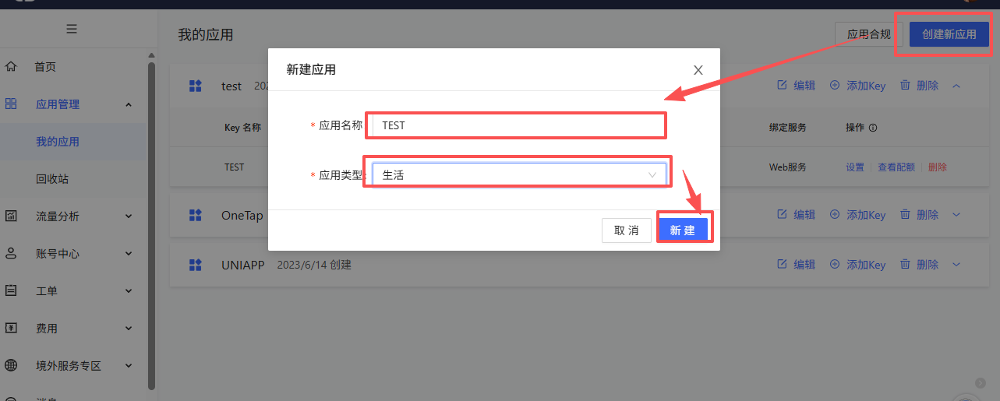
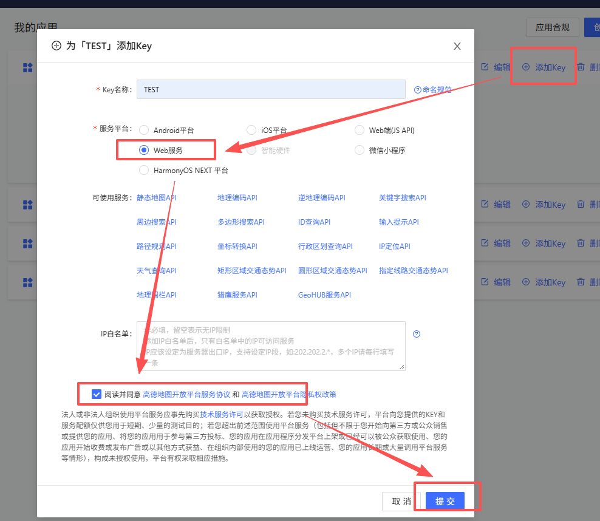

## 1.打开[高德控制台](https://console.amap.com/dev/index)

## 2.如有弹出实名认证请根据官方流程完成

## 3.点击左侧菜单栏的 【应用管理】-【我的应用】

## 4.点击右上角【创建新应用】，名称和用途随便选

## 5.在新建的应用右侧选择【添加key】，名称随便写，平台类型选择【Web服务】，同意协议后提交即可

## 6.将生成的key复制到moretalk软件的配置页填入即可
